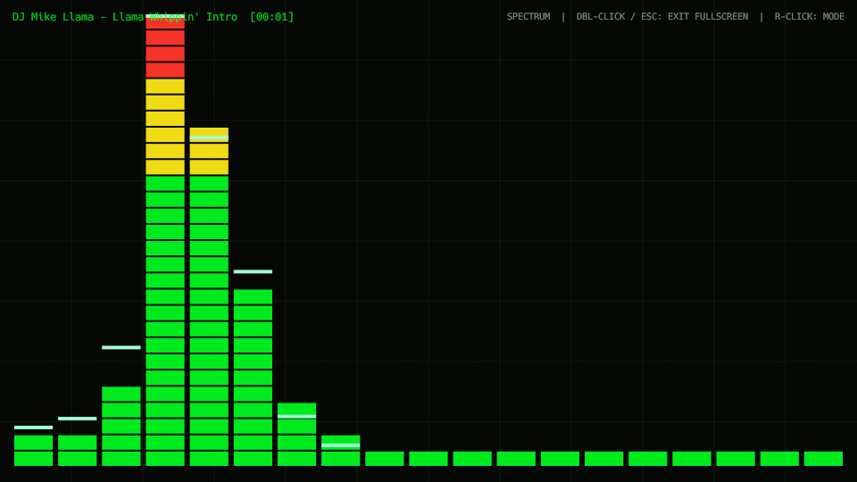

# Winamp (Rust Edition for Windows 11) ⚡

> *"It really whips the llama's ass!"*

An authentic, high-performance Winamp 2.x clone built in Rust for Windows 11. It features the classic metallic brushed chassis, 7-segment green digital clock, real-time 19-band FFT spectrum analyzer with peak gravity decay, CRT oscilloscope, 10-band equalizer with presets, and an interactive playlist manager.


### Fullscreen / Pop-out Visualizer


---

## 🚀 Quick Start

Download the standalone `winamp.exe` from the [Releases](https://github.com/vixpxGit/winamp-rust/releases) page and run it directly on Windows 11 (no extra DLLs required):
```powershell
.\winamp.exe
```

Or clone and build from source with Cargo:
```powershell
git clone https://github.com/vixpxGit/winamp-rust.git
cd winamp-rust
cargo run --release
```

---

## ✨ Features

### 1. Classic Winamp Main Window
- **Retro Brushed Titanium Chassis**: Authentically styled 90s beveled borders and Winamp title bar with lightning bolt logo.
- **7-Segment LED Digital Clock**:
  - Classic phosphor green glowing digits (`MM:SS`).
  - Click the clock to toggle between **Elapsed Time** and **Remaining Time** (with minus `-` indicator).
- **Real-Time Audio Visualizer**:
  - Click the visualizer window inside the LCD to switch modes:
    - **Spectrum Analyzer**: 19 frequency bands with segmented green-to-yellow-to-red LEDs and falling peak-hold dots with gravity decay.
    - **Oscilloscope**: Glowing CRT phosphor waveform tracing audio frames in real time.
    - **Off**: Minimal mode.
- **Marquee Text Display**: Smoothly scrolling green LCD ticker showing current track number, title, and length.
- **LED Status Indicators**: `kbps` bitrate, `kHz` sample rate, and `STEREO` / `MONO`.
- **Interactive Seeker Bar**: Scrubbable track position progress bar with striped retro indicator.
- **Volume & Balance**:
  - Level-metered volume bar (`0% - 100%`).
  - Center-notched stereo balance slider (`L --- 0 --- R`).
- **Transport Controls**:
  - `|<<` (Previous track or restart)
  - `▶` (Play)
  - `⏸` (Pause)
  - `⏹` (Stop)
  - `>>|` (Next track)
  - `⏏` (Eject / Open file dialog)
- **Windowshade Mode**: Click `=` on the title bar to collapse into a sleek 20px compact player bar.

### 2. 10-Band Equalizer (EQ) Window
- Toggle with the `EQ` button or hotkey.
- **Preamp slider** (-12dB to +12dB).
- **10 Peaking Biquad Filter sliders**: `60Hz`, `170Hz`, `310Hz`, `600Hz`, `1kHz`, `3kHz`, `6kHz`, `12kHz`, `14kHz`, `16kHz`.
- **Interactive Frequency Response Curve**: Real-time spline graph illustrating current EQ curve.
- **Built-in EQ Presets**: Cycle through `Flat`, `Rock`, `Pop`, `Techno`, `Bass Boost`, `Club`, `Classical`, `Vocal`.
- **ON Toggle**: Real-time hardware filter bypass / enable.

### 3. Playlist Editor (PL) Window
- Toggle with the `PL` button.
- Numbered track list with title and track duration right-aligned.
- Double-click any track to play instantly.
- **Toolbar Buttons**:
  - `+ FILE`: Open file dialog (select `.mp3`, `.wav`, `.flac`, `.ogg`).
  - `+ DEMO`: Add built-in synthesizer demo tracks (`Llama Whippin' Intro`, `90s Neon Chiptune`).
  - `- REM`: Remove selected track.
  - `CLEAR`: Empty playlist.
- Drag-and-drop: Drop audio files directly into the Winamp window from Windows Explorer!

---

## ⌨️ Classic Keyboard Shortcuts

| Key | Action |
| :--- | :--- |
| `X` | Play |
| `C` or `Space` | Pause / Resume |
| `V` | Stop |
| `Z` | Previous track |
| `B` | Next track |
| `L` | Open audio file dialog |
| `↑` / `↓` | Volume Up / Down (5%) |
| `←` / `→` | Seek Backward / Forward 5 seconds |

---

## 🎧 Built-In Demo Sound Generator
Even without local audio files on hand, Winamp comes with two built-in retro synthesized tracks (`Llama Whippin' Intro` with 90s funky FM bass, chiptune lead, kick and snare; and `90s Neon Chiptune`) so you can test audio and watch the spectrum analyzer bounce immediately!

---

## 🤖 Built with Google Antigravity
This project — from the Rust audio engine and 10-band biquad equalizer to the WinampR UI, custom icon, and Windows 11 release — was built completely using **Google Antigravity**.
