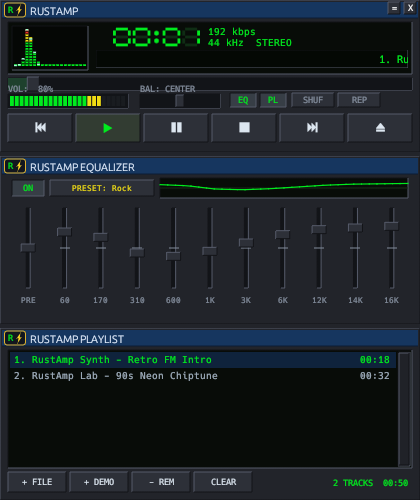
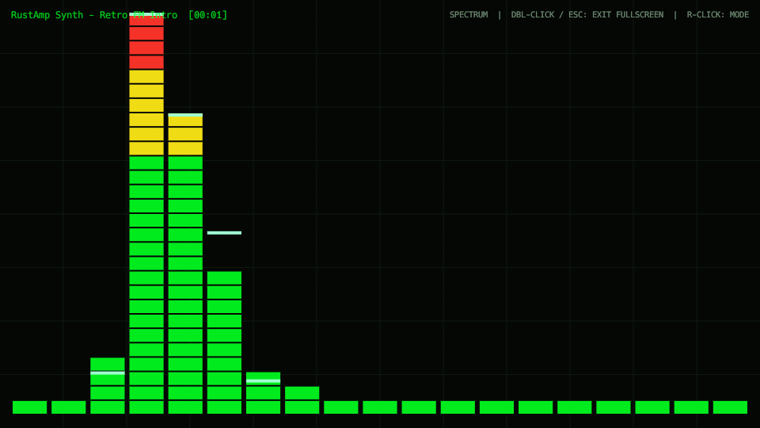

# RustAmp (Windows 11 Edition) ⚡

A classic retro audio player built in Rust for Windows 11. It features a dark brushed-metal chassis, 7-segment green digital clock, real-time 19-band FFT spectrum analyzer with peak gravity decay, CRT oscilloscope, 10-band equalizer with presets, and an auto-expanding playlist manager.



### Fullscreen / Pop-out Visualizer


---

## 🚀 Quick Start

Download the standalone `rustamp.exe` from the [Releases](https://github.com/vixpxGit/rustamp/releases) page and run it directly on Windows 11 (no extra DLLs required):
```powershell
.\rustamp.exe
```

Or clone and build from source with Cargo:
```powershell
git clone https://github.com/vixpxGit/rustamp.git
cd rustamp
cargo run --release
```

---

## ✨ Features

### 1. Classic Main Player
- **Retro Brushed Titanium Chassis**: Styled 90s beveled borders, custom `R ⚡` badge, and vertical-only window resizing.
- **7-Segment LED Digital Clock**:
  - Classic phosphor green glowing digits (`MM:SS`).
  - Click the clock to toggle between **Elapsed Time** and **Remaining Time** (with minus `-` indicator).
- **Real-Time Audio Visualizer**:
  - Single-click the visualizer window inside the LCD to switch modes:
    - **Spectrum Analyzer**: 19 frequency bands with segmented green-to-yellow-to-red LEDs and falling peak-hold dots with gravity decay.
    - **Oscilloscope**: Glowing CRT phosphor waveform tracing audio frames in real time.
    - **Off**: Minimal mode.
  - Double-click the visualizer box to pop out a separate resizable **RustAmp Visualizer** window; double-click inside it to toggle **Fullscreen** (`Esc` to exit, Right-click or `M` to switch mode).
- **Marquee Text Display**: Smoothly scrolling green LCD ticker clipped inside its display box.
- **LED Status Indicators**: `kbps` bitrate, `kHz` sample rate, and `STEREO` / `MONO`.
- **Interactive Seeker Bar**: Scrubbable track position progress bar.
- **Volume & Balance**:
  - Level-metered volume bar (`0% - 100%`).
  - Center-notched live stereo balance slider (`L --- 0 --- R`).
- **Windowshade Mode**: Click `=` on the title bar to collapse into a sleek compact player bar.

### 2. 10-Band Equalizer (EQ)
- Toggle with the `EQ` button.
- **Preamp slider** (`-12dB` to `+12dB`).
- **10 Peaking Biquad Filter sliders**: `60Hz`, `170Hz`, `310Hz`, `600Hz`, `1kHz`, `3kHz`, `6kHz`, `12kHz`, `14kHz`, `16kHz`.
- **Interactive Frequency Response Curve**: Real-time spline graph illustrating current EQ curve.
- **Built-in EQ Presets**: Cycle through `Flat`, `Rock`, `Pop`, `Techno`, `Bass Boost`, `Club`, `Classical`, `Vocal`.
- **ON Toggle**: Real-time filter bypass / enable.

### 3. Playlist Editor (PL)
- Toggle with the `PL` button; auto-expands vertically with the window, with a draggable classic scrollbar and mouse-wheel support.
- Double-click any track to play immediately.
- **Toolbar Buttons**:
  - `+ FILE`: Open file dialog (select `.mp3`, `.wav`, `.flac`, `.ogg`).
  - `+ DEMO`: Add built-in synthesizer demo tracks.
  - `- REM`: Remove selected track.
  - `CLEAR`: Empty playlist.
- **Drag & Drop**: Drop audio files directly into the player window from Windows Explorer.
- **Auto-Save**: Settings, EQ, and playlist are persisted automatically across restarts (`%APPDATA%\RustAmp\state.json`).

---

## ⌨️ Keyboard Shortcuts

| Key | Action |
| :--- | :--- |
| `X` | Play |
| `C` or `Space` | Pause / Resume |
| `V` | Stop |
| `Z` | Previous track |
| `B` | Next track |
| `L` | Open audio file dialog |
| `↑` / `↓` | Volume Up / Down (5%) |
| `←` / `→` | Seek Backward / Forward 5 seconds |

---

## 🎧 Built-In Demo Sound Generator
Even without local audio files on hand, RustAmp comes with two built-in retro synthesized tracks (`RustAmp Synth - Retro FM Intro` and `RustAmp Lab - 90s Neon Chiptune`) so you can test audio and watch the spectrum analyzer bounce immediately.

---

## 🤖 Built with Google Antigravity
This project — from the Rust audio engine and 10-band biquad equalizer to the RustAmp UI, custom `R ⚡` icon, and Windows 11 release — was built completely using **Google Antigravity**.
